<picture>
  <source media="(prefers-color-scheme: dark)" srcset="./header-dark.svg">
  
</picture>

<p align="right"><a href="https://linkedin.com/in/kisshiadejesus"><code>linkedin ↗</code></a> <a href="mailto:kisshia.dejesus@gmail.com"><code>email ↗</code></a> <a href="https://github.com/kisshia?tab=repositories"><code>all repos ↗</code></a></p>

### 01 — about
Fourth-year BS Information Systems student at UST, specializing in Business Analytics. I build both ends of a project: the dashboards that make data readable, and the interfaces people click through.

| | |
|:--|:--|
| **now** | building a decision support system in Data Studio for my capstone (UST Hospital MIS) |
| **led** | student teams of up to 8 as project lead and frontend lead |
| **noted** | Dean's Lister · Lean Six Sigma White Belt |
| **off-screen** | dog person, always · Spider-Man fan · with great data comes great responsibility |

### 02 — selected work
| N° | project | role | year |
|:--|:--|:--|--:|
| 01 | [**ICSSCentral**](https://github.com/kisshia/icssc-central) <br/><sub>student council platform: directory, STRAW Desk, FOI portal</sub> | front-end lead | 2025–26 |
| 02 | [**Lifestyle Roaster**](https://github.com/kisshia/lifestyle-roaster) <br/><sub>e-wallet spending analyzer with TF-IDF classification</sub> | front-end lead | 2026 |
| 03 | [**Jollibee Market Basket**](https://github.com/kisshia/jollibee-market-basket-analysis) <br/><sub>FP-Growth association rules for combos and promos</sub> | developer | 2026 |
| 04 | [**CueReserve**](https://github.com/kisshia/cue-reserve) <br/><sub>billiards table reservations, REST API, JWT login</sub> | project lead | 2025 |
| 05 | [**Swift.co**](https://github.com/kisshia/swift-co) <br/><sub>e-commerce site for Ferrari-inspired merchandise</sub> | project lead | 2025 |

### 03 — toolkit
```txt
data        python · sql · pandas · scikit-learn
bi          databricks · data studio · power bi
frontend    react · next.js · react native · expo · typescript
styling     tailwind · bootstrap · html · css
backend     node.js · express · fastapi
databases   mysql · postgresql · supabase
design      figma · canva · wireframing · prototyping · user research
process     agile · requirements analysis · process mapping
tools       jira · trello · miro · notion
```

<picture>
  <source media="(prefers-color-scheme: dark)" srcset="./footer-dark.svg">
  
</picture>
