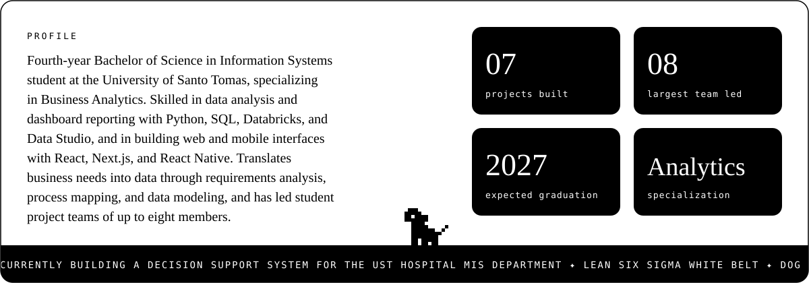
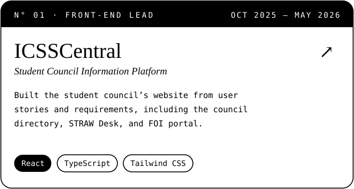
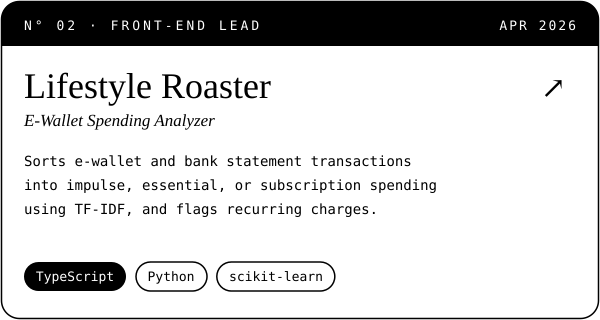
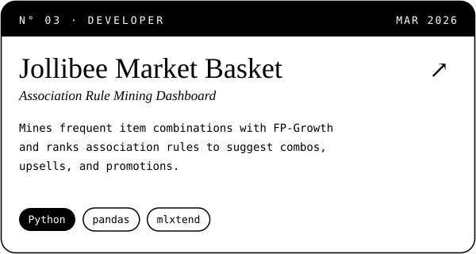
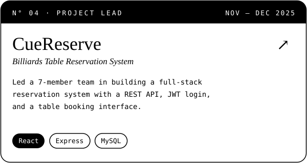
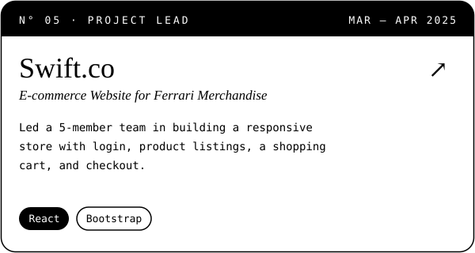
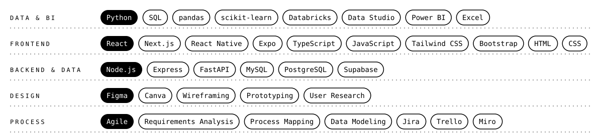

<a href="https://linkedin.com/in/kisshiadejesus"><code>linkedin ↗</code></a> <a href="mailto:kisshia.dejesus@gmail.com"><code>email ↗</code></a> <a href="https://github.com/kisshia?tab=repositories"><code>all repos ↗</code></a>

### 01 — about

### 02 — selected work

### 03 — toolkit

<picture>
  <source media="(prefers-color-scheme: dark)" srcset="./footer-dark.svg">
  
</picture>
